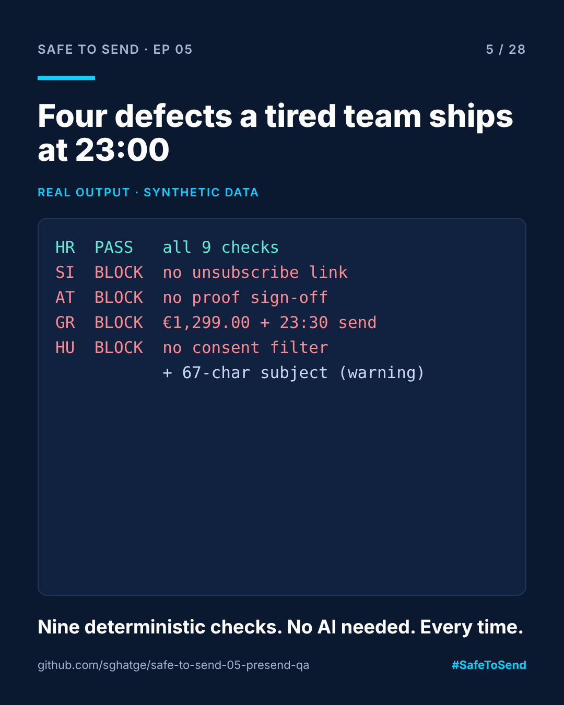

# safe-to-send-05 · Pre-Send QA



**Safe to Send · Episode 05** — a 28-day learn-in-public series on governing AI in CRM operations.

> Four defects a tired team ships at 23:00, and the nine checks that catch them first.

## The real-world scenario

Four markets, four classic mistakes. Slovenia goes out with no unsubscribe link. Austria has no proof sign-off. Greece shows prices in English format and sends at 23:30. Hungary forgot the marketing-consent filter. In real operations, a customer, a complaint or a regulator usually finds these first.

## Run it

```bash
python presend_qa.py examples/deliveries.json
```

## Real example output

```
HR  BF-HR-01   PASS  all 9 checks passed
SI  BF-SI-01   BLOCK no unsubscribe link
AT  BF-AT-01   BLOCK no proof sign-off
GR  BF-GR-01   BLOCK English price format in a local-format market; 23:30 local is outside 08:00-21:00
HU  BF-HU-01   BLOCK no marketing-consent filter; subject 67 chars (over 50: warning)
```

Exit code is 1 when anything blocks, so it drops into CI or a scheduled job.

## The nine checks

| Check | Level | Why it matters |
|---|---|---|
| Unsubscribe link | error | Legal requirement for marketing email |
| Market legal footer | error | Company and legal details per market |
| Price and currency locale | error | "€1,299.00" reads wrong in most EU markets |
| Marketing-consent filter | error | The audience must exclude non-opted-in recipients |
| Proof sign-off | error | A named person approved the final proof |
| Local quiet hours | error | No 23:30 sends in the recipient's time zone |
| Marketing typology | error | Business rules (pressure, fatigue) are applied |
| Seed list | error | You can see what actually landed |
| Subject 50 characters or less | warning | Long subjects truncate on mobile |

Adapt `MARKET_RULES` for your own send windows and formats.

## Where this fits

The same checks run inside [ACC Agent Gate](https://github.com/sghatge/acc-agent-gate) before any agent-initiated send.

Independent project, not affiliated with Adobe. Synthetic data only. MIT · [Sangram Ghatge](https://www.linkedin.com/in/sangram-g-2369705b) · #SafeToSend
